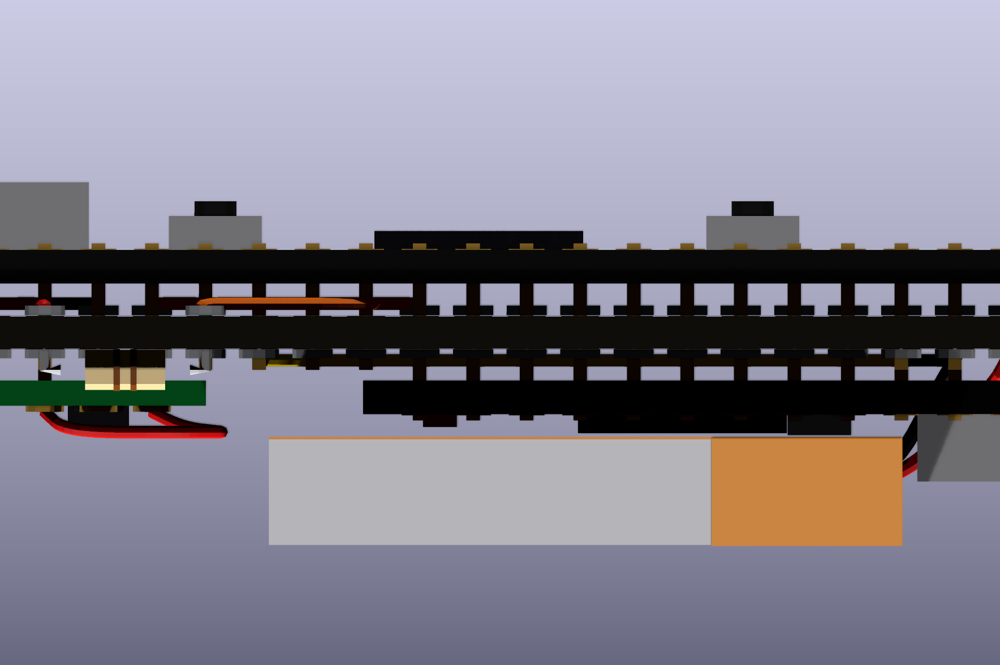

# 20261030_3D — 麵包板線路還原與 3D 模型

由同一塊麵包板的三張照片交叉判讀出接線位置，畫成原理圖，再做成 3D 模型。

- 左：Pro Micro nRF52840（nice!nano v2 相容）
- 右：WeAct BlackPill（STM32F401/F411）
- 中：U3 = **DMC2038LVT**（Diodes，互補 MOSFET：Q1 N 通道＋Q2 P 通道，TSOT26），裝在 SOT-23 轉 DIP 轉接板上；S1 接 GND、G2 接 BlackPill 5V、G1↔D2 相連，R1 跨在 D1 與 D2 之間（腳位對應依 1 號腳在欄27上推定）
- 其他：LiPo 電池（＋ 接 nRF RAW）、兩組 SWD 引出排針（nRF 側 J4⇄J1、BlackPill 側 J3⇄J2）

> 所有零件與跳線都依判讀出的麵包板座標（欄 1–63、列 a–j）擺放，判讀誤差約 ±1 欄。

## 分區說明圖

## 3D 圖

### 整體斜視

### U3（DMC2038LVT）特寫

### 俯視

### 正面低角度

### 反向斜視

## 檔案

| 檔案 | 內容 |
|---|---|
| `breadboard_annotated.png` / `.svg` | 分區說明圖（A–H 功能分區＋訊號與電源路徑） |
| `breadboard_restore.kicad_sch` | KiCad 原理圖 |
| `breadboard_restore_kicad.pdf` / `.svg` | KiCad 匯出的原理圖 |
| `breadboard_restore.svg` / `_preview.png` | 示意圖 |
| `3D/*.png` | 3D 算圖 |
| `3D/breadboard_3d.kicad_pcb` | 用 KiCad 開啟後按 **Alt+3** 可旋轉檢視 |
| `3D/breadboard_3d.wrl` | 3D 模型（要跟 kicad_pcb 放在同一個資料夾） |
| `scripts/` | 產生上述檔案的 Python 腳本 |

## 洞洞板產品 layout（兩個版本）

接線照上面修正後的線路，並做了兩項產品改動：拿掉除錯排針、電池負極改接 GND（另加兩板共地線）。兩版的 USB-C 都是一左一右。

| 版本 | 洞洞板 | 特點 |
|---|---|---|
| [平面版（兩板並排）](perfboard/flat/) | 23×18 孔，58.4 × 45.7 mm | 兩塊板子都在正面，nice!nano 天線端淨空，藍牙收訊較好 |
| [最小化版（上下疊放）](perfboard/stacked/) | 22×10 孔，55.9 × 25.4 mm，厚約 17 mm | BlackPill 在正面，nice!nano、U3、R1、電池在反面；面積少一半，但藍牙收訊會變差 |

每個資料夾裡的 `wiring.md` 是孔位與接線表；`.kicad_pcb` 用 KiCad 開啟後按 **Alt+3** 可旋轉檢視（要跟同資料夾的 `.wrl` 放在一起）。電池尺寸 30×25×5 mm 為照片估計值。

### 平面版

### 最小化版

## PCB 正反面並排（檢視用）

[`pcb/pcb_front_back_side_by_side.kicad_pcb`](pcb/)：用 KiCad 打開，**左邊是正面、右邊是已翻過來的背面**，不用手動翻轉；按 Alt+3 可看 3D 光板（只保留板上實際焊的 U3 DMC2038LVT 與 R1）。
這個檔只供檢視，兩塊板放在同一檔裡，不能直接拿去打樣。

