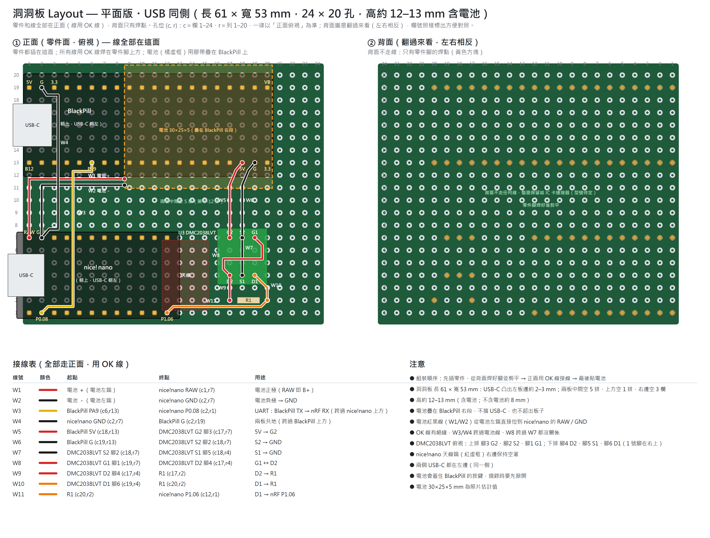
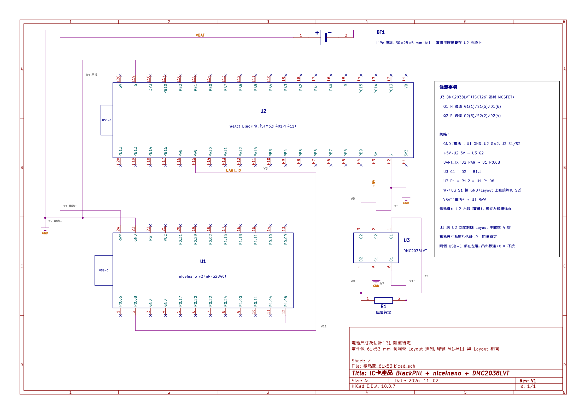

# 20261030_3D — 洞洞板版（長 61 × 寬 53 mm）

nice!nano（nRF52840）＋ WeAct BlackPill（STM32F401/F411）＋ DMC2038LVT，焊在一塊 61 × 53 mm 洞洞板上。
零件和線全部在正面（線用 OK 線），背面只有零件腳的焊點，整面保留給 IC 卡連接器（型號待定）。

## 尺寸（mm）

| | 尺寸 | 說明 |
|---|---|---|
| 長 | 約 64 | 洞洞板 61，加上兩個 USB-C 凸出左板邊約 2–3 |
| 寬 | 53 | USB-C 那一邊 |
| 高 | 約 12.5 | 含電池；不含電池約 8 |

高度：背面針腳＋焊點 1.0–1.5、洞洞板 1.6、間隙 0.5、BlackPill 1.6、按鍵 2.3、膠帶 0.2、電池 5。

## 規格

| 項目 | 內容 |
|---|---|
| 洞洞板 | 61 × 53 mm，24 × 20 孔，2.54 mm 間距 |
| 孔位標示 | (欄 c, 列 r)：c 為 1–24（左→右），r 為 1–20（下→上），正面俯視 |
| USB-C | 兩個都朝左，凸出左板邊約一節 |
| 排列 | BlackPill 在上（第 13、19 列），nice!nano 在下（第 1、7 列），兩板中間空 5 列（第 8–12 列） |
| 電池 | LiPo 30 × 25 × 5 mm（照片估計），用膠帶疊在 BlackPill 右段，不超出板子 |
| 正面 | 所有零件＋所有 OK 線 |
| 背面 | 不走線，只有焊點（剪平），保留給 IC 卡連接器 |

## 零件位置（全部在正面）

| 零件 | 孔位 |
|---|---|
| BlackPill | r13：B12 c1 … PA9 c6 … 5V c18、G c19、3V3 c20；r19：5V c1、G c2、3V3 c3 … VB c20 |
| nice!nano | r1：P0.06 c1、P0.08 c2、GND c3/c4 … P1.06 c12；r7：RAW c1、GND c2、RST c3、VCC c4 … P0.09 c12 |
| DMC2038LVT（SOT-23-6 轉接板） | 俯視，1 號腳在右上：r7：腳3 G2 c17、腳2 S2 c18、腳1 G1 c19；r4：腳4 D2 c17、腳5 S1 c18、腳6 D1 c19 |
| R1 | c17 r2 ↔ c20 r2 |

## 接線（全部走正面，用 OK 線）

| 線號 | 起點 | 終點 | 用途 |
|---|---|---|---|
| W1 | 電池 ＋（電池左端） | nice!nano RAW (c1,r7) | 電池正極（RAW 即 B+） |
| W2 | 電池 －（電池左端） | nice!nano GND (c2,r7) | 電池負極 → GND |
| W3 | BlackPill PA9 (c6,r13) | nice!nano P0.08 (c2,r1) | UART：BlackPill TX → nRF RX（跨過 nice!nano 上方） |
| W4 | nice!nano GND (c2,r7) | BlackPill G (c2,r19) | 兩板共地（跨過 BlackPill 上方） |
| W5 | BlackPill 5V (c18,r13) | DMC2038LVT G2 腳3 (c17,r7) | 5V → G2 |
| W6 | BlackPill G (c19,r13) | DMC2038LVT S2 腳2 (c18,r7) | S2 → GND |
| W7 | DMC2038LVT S2 腳2 (c18,r7) | DMC2038LVT S1 腳5 (c18,r4) | S1 → GND |
| W8 | DMC2038LVT G1 腳1 (c19,r7) | DMC2038LVT D2 腳4 (c17,r4) | G1 ↔ D2 |
| W9 | DMC2038LVT D2 腳4 (c17,r4) | R1 (c17,r2) | D2 → R1 |
| W10 | DMC2038LVT D1 腳6 (c19,r4) | R1 (c20,r2) | D1 → R1 |
| W11 | R1 (c20,r2) | nice!nano P1.06 (c12,r1) | D1 → nRF P1.06 |

## 線路圖

零件依洞洞板 Layout 排列，線號 W1–W11 與 Layout 相同。KiCad 原始檔：[`schematic/schematic_61x53.kicad_sch`](schematic/schematic_61x53.kicad_sch)（另有 [PDF](schematic/schematic_61x53.pdf)）。

| 網路 | 連接 |
|---|---|
| VBAT | 電池＋ → nice!nano RAW |
| GND | 電池－、nice!nano GND、BlackPill G ×2、DMC2038LVT S1/S2 |
| +5V | BlackPill 5V → DMC2038LVT G2 |
| UART_TX | BlackPill PA9 → nice!nano P0.08 |
| — | DMC2038LVT G1 ＝ D2 ＝ R1 一端 |
| — | DMC2038LVT D1 ＝ R1 另一端 ＝ nice!nano P1.06 |

## 組裝注意

1. 先插零件，從背面焊好腳並剪平 → 正面用 OK 線接線 → 最後貼電池。
2. DMC2038LVT 請照轉接板上印的腳號（1–6）焊：5V 接腳 3、GND 接腳 2 與腳 5、腳 1 接腳 4 與 R1、腳 6 接 R1 另一端與 P1.06。
3. OK 線有絕緣，W3/W4 跨過電池線、W8 跨過 W7 都沒關係。
4. W5、W6 的焊點在電池下方，先焊好再貼電池；電池會蓋住 BlackPill 的按鍵，燒錄時要先掀開。
5. nice!nano 天線端右邊保持空著。
6. R1 阻值待定；電池尺寸為照片估計。

## 檔案

| 檔案 | 用途 |
|---|---|
| [`perfboard/perfboard_layout_61x53.png`](perfboard/perfboard_layout_61x53.png) / [`.svg`](perfboard/perfboard_layout_61x53.svg) | 洞洞板 Layout（正面、背面、接線表） |
| [`schematic/`](schematic/) | 線路圖（KiCad 原始檔、PDF、PNG） |
| `scripts/gen_layout_6153.py`、`scripts/gen_schematic_6153.py` | 產生 Layout 圖與線路圖的程式 |
| [`pcb_flat/`](pcb_flat/) | 先前的 PCB 平面版（53 × 40 mm，USB-C 不同邊），保留參考 |
