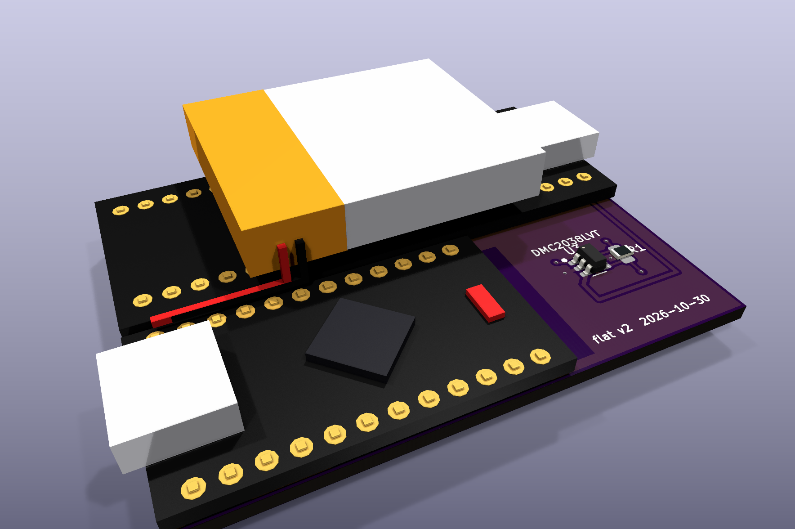
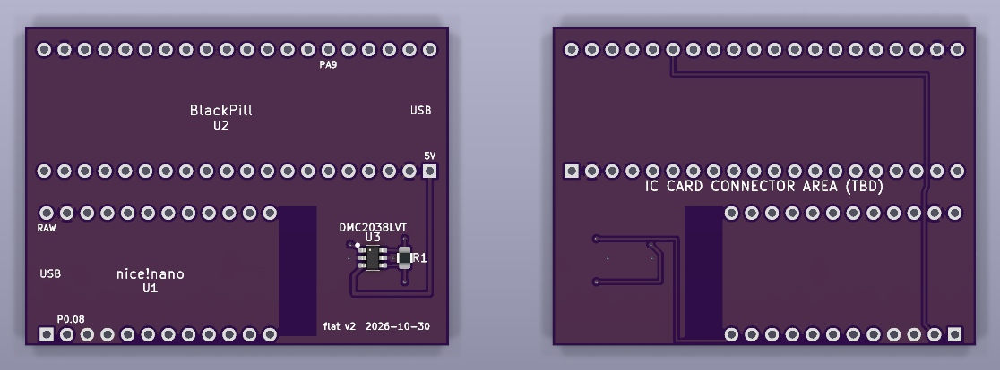
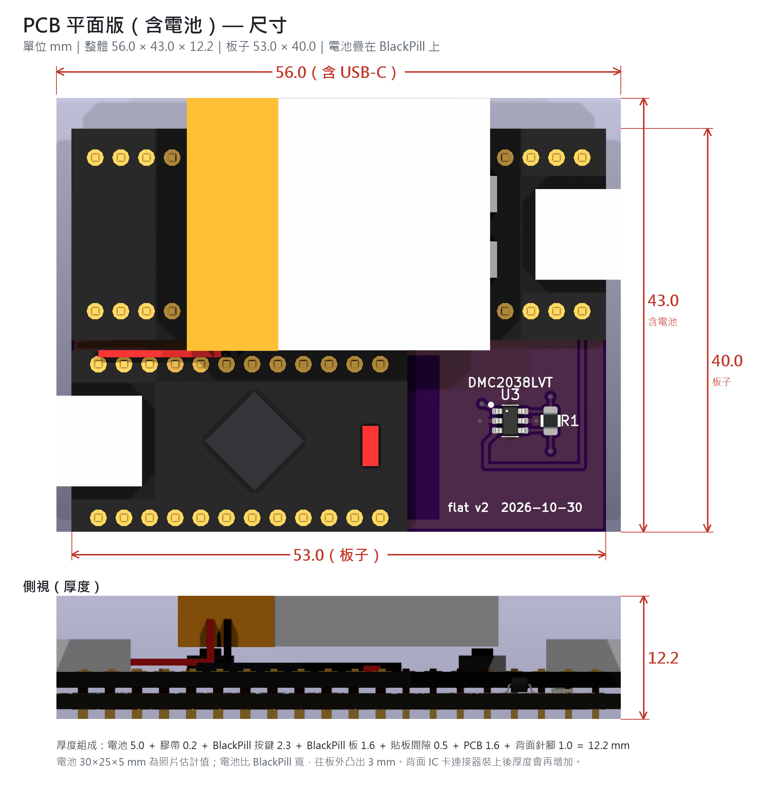

# 20261030_3D — PCB 平面版

nice!nano（nRF52840）＋ WeAct BlackPill（STM32F401/F411）＋ DMC2038LVT 的 2 層 PCB。
兩塊開發板都在正面，電池疊在 BlackPill 上，背面保留給 IC 卡連接器（型號待定）。

## 正反面

左：正面　右：背面（已翻過來）

## 尺寸（mm）

**整體 56.0 × 43.0 × 12.2（含電池、兩端 USB-C）｜板子 53.0 × 40.0**

## 規格

| 項目 | 內容 |
|---|---|
| 板子 | 53.0 × 40.0 mm，2 層，1.6 mm FR4 |
| 整體（含電池、兩端 USB-C） | 約 56.0 × 43.0 × 12.2 mm |
| 電池 | LiPo 約 30 × 25 × 5 mm（照片估計），用膠帶疊在 BlackPill 上，往板外凸出 3 mm；線焊到 nice!nano 的 B+ / B− |
| 正面 | BlackPill（上半，USB-C 朝右）、nice!nano（下半，USB-C 朝左）、DMC2038LVT（SOT-23-6）、R1（0805） |
| 背面 | 無零件，保留給 IC 卡連接器 |
| 鋪銅 | 正反兩面接地鋪銅；nice!nano 天線端下方不鋪銅、不走線 |
| DRC | 0 違規、0 未連接（[`drc_report.txt`](pcb_flat/drc_report.txt)） |

## 連線

| 連線 | 說明 |
|---|---|
| UART | BlackPill PA9（TX）→ nice!nano P0.08（RX） |
| +5V | BlackPill 5V → DMC2038LVT G2 |
| GND | nice!nano GND、BlackPill G、DMC2038LVT S1/S2（鋪銅） |
| G1 ↔ D2 ↔ R1 | DMC2038LVT G1、D2 與 R1 一端 |
| D1 ↔ R1 ↔ P1.06 | DMC2038LVT D1、R1 另一端與 nice!nano P1.06 |

## 檔案（[`pcb_flat/`](pcb_flat/)）

| 檔案 | 用途 |
|---|---|
| `flat_pcb.kicad_pcb` / `.kicad_pro` | PCB 原始檔，用 KiCad 開啟（按 Alt+3 看 3D，含電池；`flatpcb_*.wrl` 要放同一資料夾） |
| `flat_pcb_gerber.zip` | Gerber＋鑽孔，可直接上傳板廠 |
| `front_back_view.kicad_pcb` | 打開即是正反面並排（只供檢視，不可拿去打樣） |
| `dimensions.png` | 尺寸標示圖（長、寬、厚） |
| `3d_top_iso.png`、`3d_side.png`、`front_back.png` | 預覽圖 |

## 組裝注意

1. 兩塊模組貼板焊（間隙約 0.5 mm），背面針腳剪平。
2. 電池用絕緣膠帶貼在 BlackPill 上（會蓋住 BlackPill 的按鍵），紅黑線焊到 nice!nano 的 B+ / B− 焊盤，不經過這塊板子。
3. R1 阻值待定。
