# 20261030_3D — 麵包板線路還原 → 洞洞板 → PCB

由同一塊麵包板的三張照片，交叉判讀出接線，依序做成原理圖、3D 模型、洞洞板 layout 與 PCB 檢視檔。

| 步驟 | 內容 | 位置 |
|---|---|---|
| 1. 線路還原 | 原理圖、分區說明圖 | 根目錄 |
| 2. 3D 模型 | 麵包板組裝的 3D 圖 | [`3D/`](3D/) |
| 3. 洞洞板 | 兩種 layout（平面版、最小化版） | [`perfboard/`](perfboard/) |
| 4. PCB | 正反面並排檢視檔 | [`pcb/`](pcb/) |

## 電路組成

| 編號 | 元件 | 說明 |
|---|---|---|
| U1 | nice!nano v2 相容板（nRF52840） | 藍牙 MCU，電池接在 RAW |
| U2 | WeAct BlackPill（STM32F401/F411） | 由自己的 USB-C 供電 |
| U3 | **DMC2038LVT**（Diodes 互補 MOSFET，N＋P 通道，TSOT26） | 裝在 SOT-23 轉 DIP 轉接板上 |
| R1 | 電阻 | 跨在 U3 的 D1 與 D2 之間 |
| BT1 | LiPo 電池 | |

### 主要連線

| 連線 | 說明 |
|---|---|
| UART | BlackPill PA9（TX）→ nice!nano P0.08（RX） |
| +5V | BlackPill 5V → U3 G2 |
| GND | nice!nano GND → U3 S1 |
| U3 G1 ↔ D2 ↔ R1 | 轉接板上那條紅線 |
| U3 D1 ↔ R1 ↔ nice!nano P1.06 | |

> 欄位以麵包板座標（欄 1–63、列 a–j）表示，判讀誤差約 ±1 欄；U3 腳位對應依「1 號腳在欄 27 上」推定。

---

## 1. 線路還原

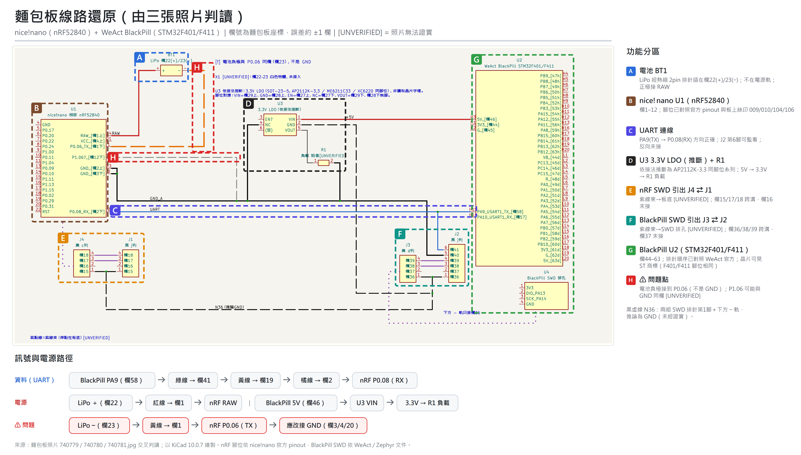

| 檔案 | 內容 |
|---|---|
| `breadboard_annotated.png` / `.svg` | 分區說明圖（A–H 功能分區＋訊號與電源路徑） |
| `breadboard_restore.kicad_sch` | KiCad 原理圖 |
| `breadboard_restore_kicad.pdf` / `.svg` | KiCad 匯出的原理圖 |
| `breadboard_restore.svg` / `_preview.png` | 手繪版示意圖 |

## 2. 3D 模型

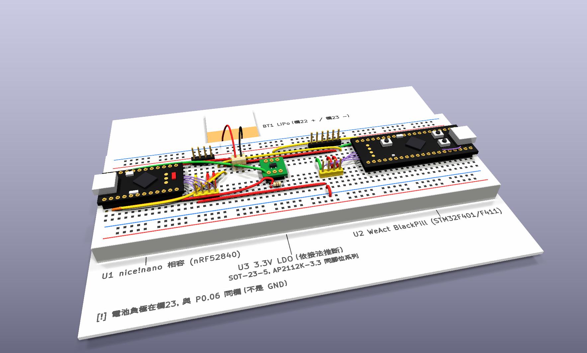

| U3（DMC2038LVT）特寫 | 俯視 |
|---|---|
| 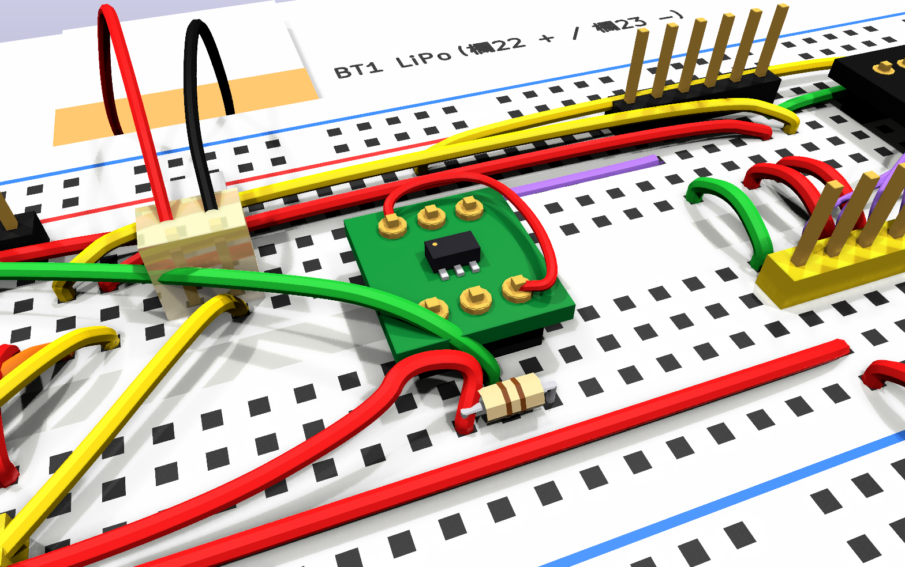 | 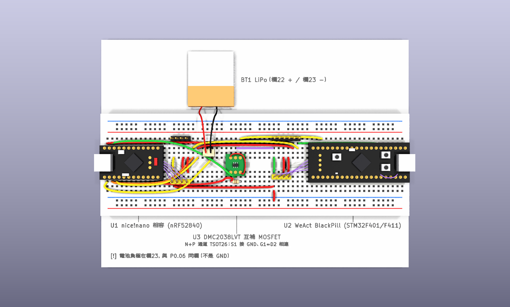 |
| **正面低角度** | **反向斜視** |
| 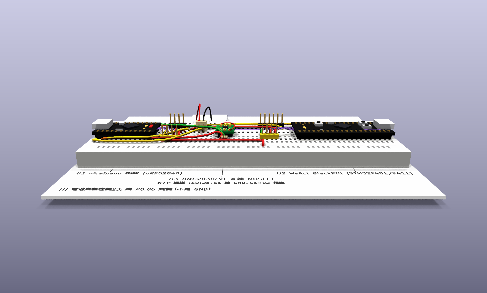 | 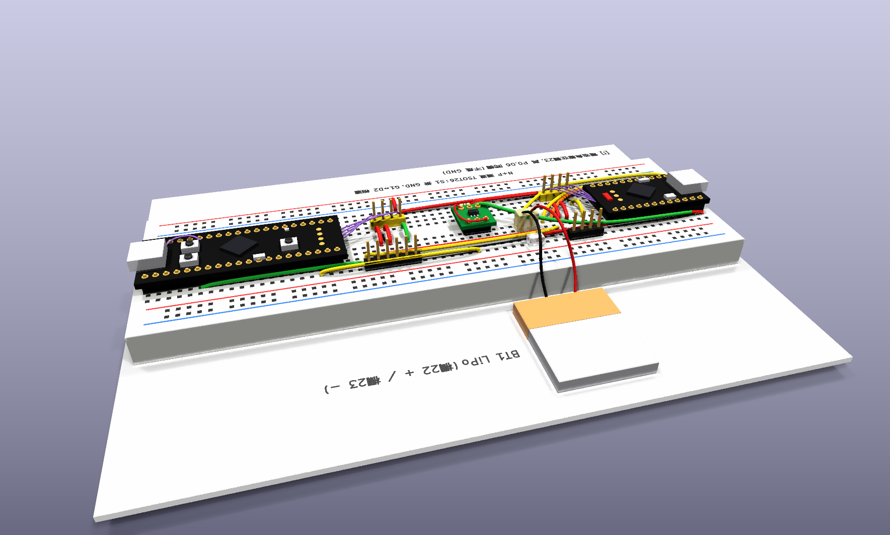 |

用 KiCad 開 `3D/breadboard_3d.kicad_pcb`，按 **Alt+3** 可旋轉檢視（`.wrl` 要放在同一個資料夾）。

## 3. 洞洞板 layout

照上面的線路做成產品，並做了兩項改動：拿掉除錯排針、電池負極改接 GND（另加兩板共地線）。兩版的 USB-C 都是一左一右。

| 版本 | 尺寸 | 特點 |
|---|---|---|
| [平面版（兩板並排）](perfboard/flat/) | 23×18 孔，58.4 × 45.7 mm | 兩塊板都在正面，nice!nano 天線端淨空，藍牙收訊較好 |
| [最小化版（上下疊放）](perfboard/stacked/) | 22×10 孔，55.9 × 25.4 mm，厚約 17 mm | 面積少一半，但 nice!nano 夾在中間，藍牙收訊較差 |

| 平面版 | 最小化版 |
|---|---|
| 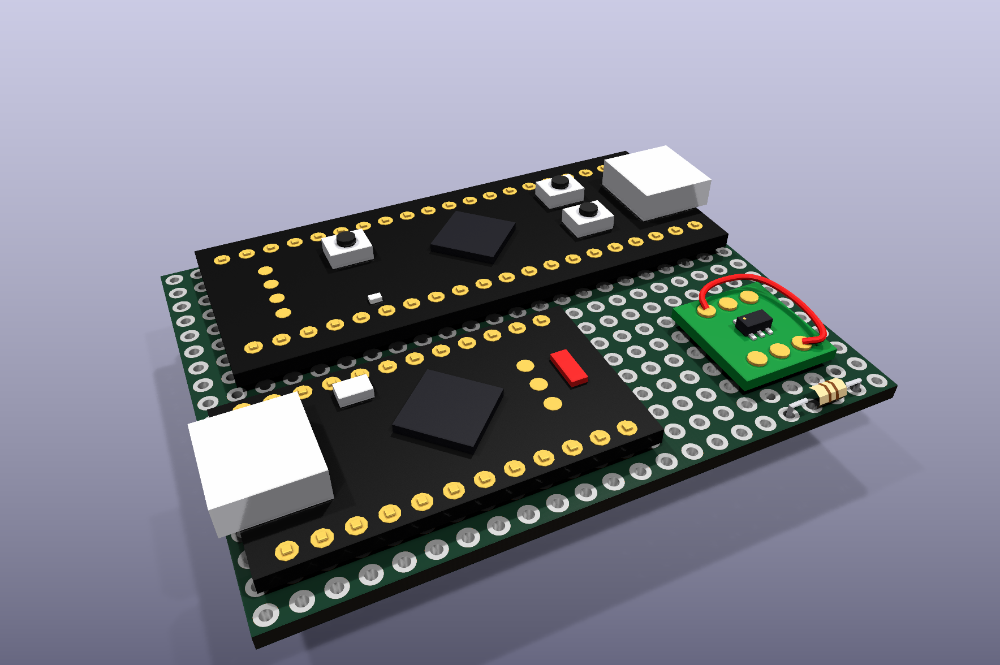 | 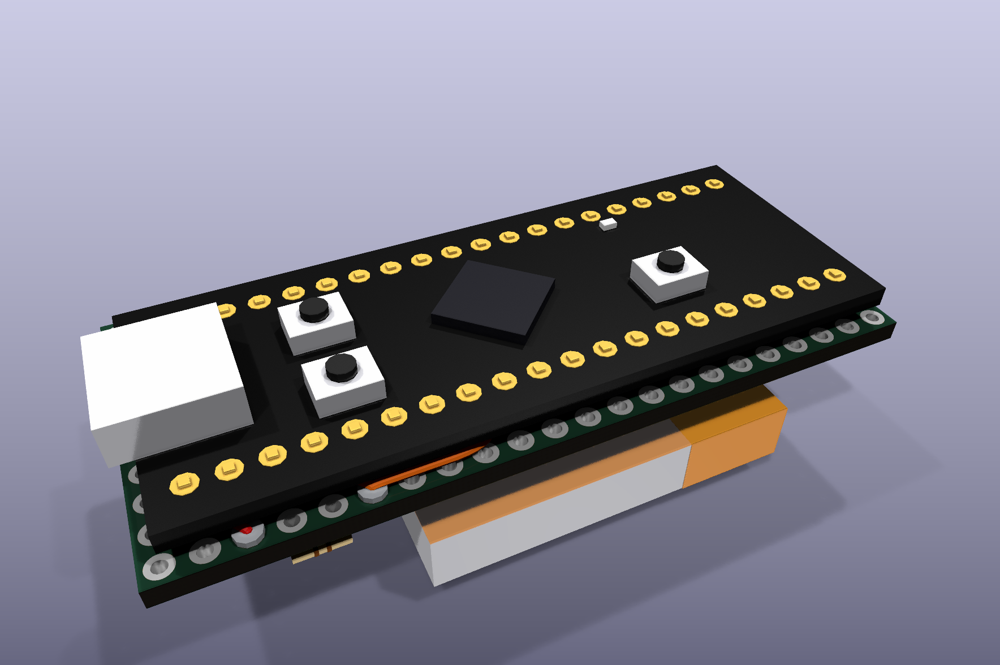 |
| 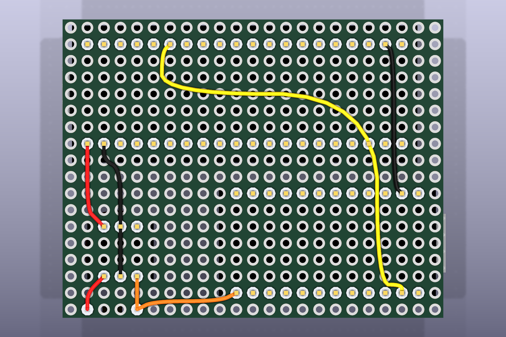 | 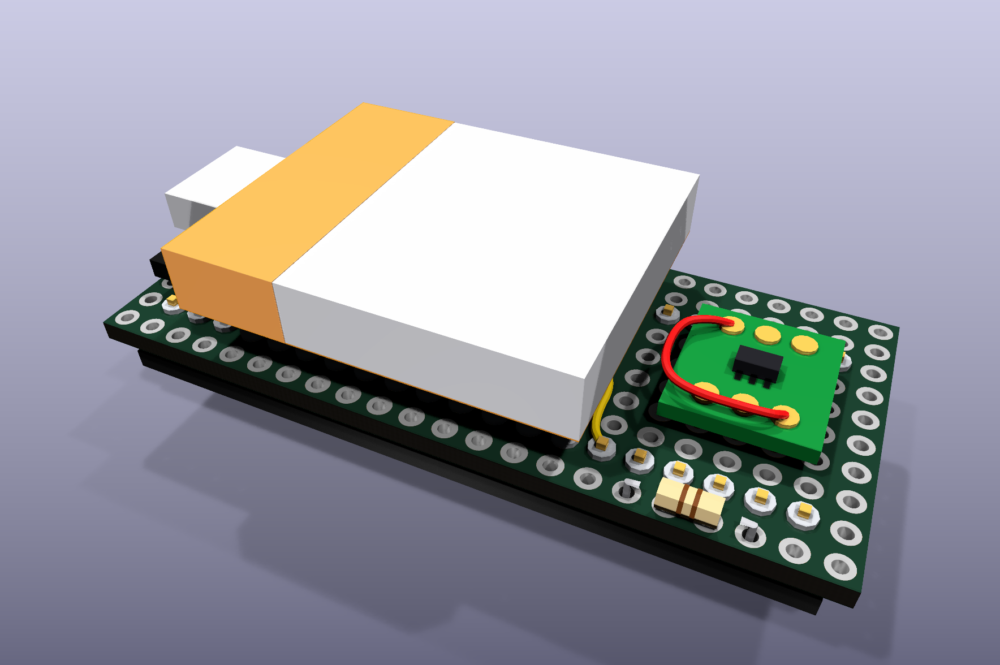 |

每個資料夾裡的 `wiring.md` 是孔位與接線表；`.kicad_pcb` 用 KiCad 開啟後按 **Alt+3** 可旋轉檢視（要跟同資料夾的 `.wrl` 放在一起）。電池尺寸 30×25×5 mm 為照片估計值。

## 4. PCB（正反面並排檢視）

用 KiCad 打開 [`pcb/pcb_front_back_side_by_side.kicad_pcb`](pcb/)，**左邊是正面、右邊是已翻過來的背面**，不用手動翻轉；按 **Alt+3** 可看 3D 光板。

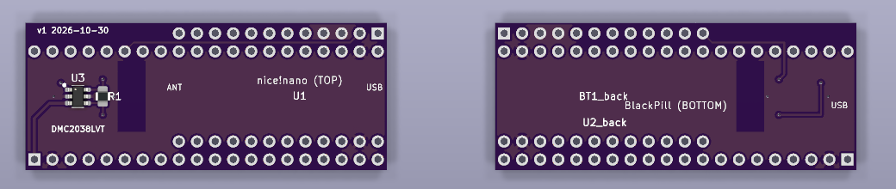
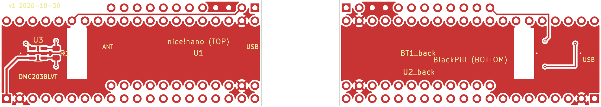

- 2 層板，50.8 × 20.8 mm；nice!nano、U3（DMC2038LVT，SOT-23-6 直接焊）、R1（0805）在正面，BlackPill 在背面。
- 正反兩面鋪滿接地銅，nice!nano 天線端下方不鋪銅、不走線。
- 這個檔把兩塊板放在同一檔裡，只供檢視，不能直接拿去打樣。

## 目錄

```
├─ README.md
├─ breadboard_*.{kicad_sch,pdf,svg,png}   線路還原
├─ 3D/                                    麵包板 3D 模型與算圖
├─ perfboard/
│  ├─ flat/                               洞洞板平面版
│  └─ stacked/                            洞洞板最小化版
├─ pcb/                                   PCB 正反面並排檢視
└─ scripts/                               產生上述檔案的 Python 腳本
```
