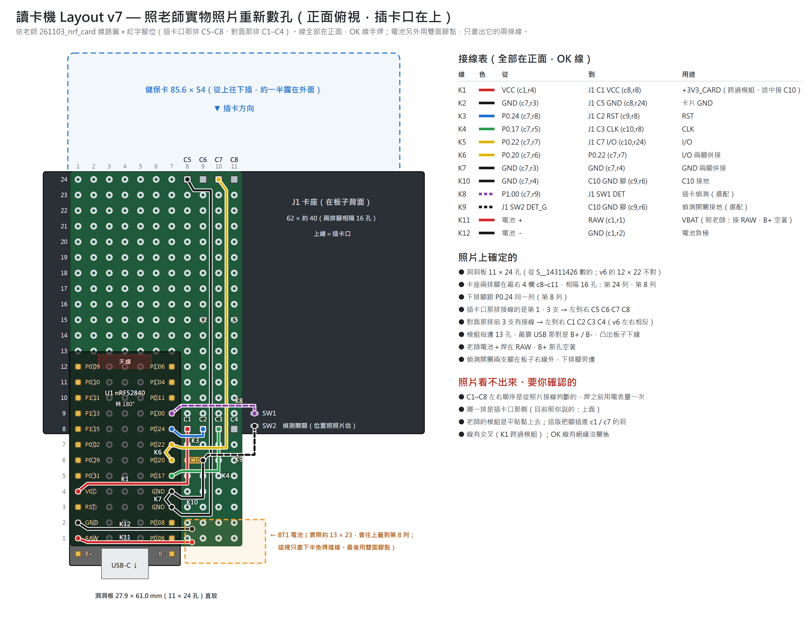

# 20261030_3D — 讀卡機（單顆 nRF52840＋健保卡卡座）

只用一顆 nRF52840 模組（nice!nano v2 腳位）接 ISO 7816 卡座，焊在一塊 11 × 24 孔的洞洞板上。
卡座在板子背面、插卡口在上，模組的 USB-C 朝下，線全部在正面用 OK 線手焊，電池最後用雙面膠黏。

目前版本是 v7。

## 規格

| 項目 | 內容 |
|---|---|
| 洞洞板 | 27.9 × 61 mm，11 × 24 孔，2.54 mm 間距，直放 |
| 孔位標示 | (欄 c, 列 r)：c 為 1–11（左→右），r 為 1–24（下→上），正面俯視 |
| 卡座 J1 | 約 62 × 40 mm，在板子背面，上緣是插卡口；8 支腳焊進 c8–c11 的第 24 列和第 8 列 |
| 模組 U1 | 腳在 c1、c7 的第 1–12 列，轉 180°，USB-C 從板子下緣凸出；每邊 13 孔，最靠 USB 那對 B+ / B- 在板子外 |
| C10 | 0.1 µF，c8、c9 的第 6 列 |
| 電池 | LiPo 約 13 × 23 mm（照片估），在模組右邊，蓋在線上面 |

## 卡座腳位

| 位置 | c8 | c9 | c10 | c11 |
|---|---|---|---|---|
| 插卡口那排（第 24 列） | C5 GND | C6 | C7 I/O | C8 |
| 對面那排（第 8 列） | C1 VCC | C2 RST | C3 CLK | C4 |

C4、C6、C8 不接線，腳還是焊進洞，用來固定卡座。

## 接線（全部走正面，用 OK 線）

| 線號 | 起點 | 終點 | 用途 |
|---|---|---|---|
| K1 | VCC (c1,r4) | J1 C1 VCC (c8,r8) | +3V3_CARD，跨過模組，途中接 C10 |
| K2 | GND (c7,r3) | J1 C5 GND (c8,r24) | 卡片 GND |
| K3 | P0.24 (c7,r8) | J1 C2 RST (c9,r8) | RST |
| K4 | P0.17 (c7,r5) | J1 C3 CLK (c10,r8) | CLK |
| K5 | P0.22 (c7,r7) | J1 C7 I/O (c10,r24) | I/O |
| K6 | P0.20 (c7,r6) | P0.22 (c7,r7) | I/O 兩腳併接 |
| K7 | GND (c7,r3) | GND (c7,r4) | GND 兩腳併接 |
| K10 | GND (c7,r4) | C10 GND 腳 (c9,r6) | C10 接地 |
| K8 | P1.00 (c7,r9) | J1 SW1 DET | 插卡偵測（選配） |
| K9 | J1 SW2 DET_G | C10 GND 腳 (c9,r6) | 偵測開關接地（選配） |
| K11 | 電池 ＋ | RAW (c1,r1) | VBAT |
| K12 | 電池 － | GND (c1,r2) | 電池負極 |

卡片的 VCC 由模組上的 MOSFET 開關（P0.13 / EXT_POWER），所以可以斷電重開卡片。

## 還沒確定的

| 項目 | 目前做法 | 怎麼確認 |
|---|---|---|
| C1–C8 的左右順序 | 照實物照片的接線判斷 | 焊之前用電表量 |
| 插卡口在哪一排 | 放上面 | 實際插卡看 |
| 偵測開關 SW1 / SW2 的腳位 | 畫在板子右緣外、第 8 列旁邊 | 看卡座實物 |
| J2 燒錄 3 pin 的接法 | 先不接 | 待確認 |
| 電池大小 | 約 13 × 23 mm | 量電池 |

## 檔案

| 檔案 | 用途 |
|---|---|
| [`card_reader_nicenano/讀卡機Layout_v7.png`](card_reader_nicenano/讀卡機Layout_v7.png) / [`.svg`](card_reader_nicenano/讀卡機Layout_v7.svg) | 目前的 Layout（含接線表） |
| `card_reader_nicenano/gen_layout_card7.py` | 產生 v7 圖的程式 |
| [`card_reader_nicenano/讀卡機_整理.md`](card_reader_nicenano/讀卡機_整理.md) | 整理筆記（內容寫到 v6） |
| `card_reader_nicenano/` 其他檔案 | v1–v6 的舊版 Layout 和程式，保留參考 |
