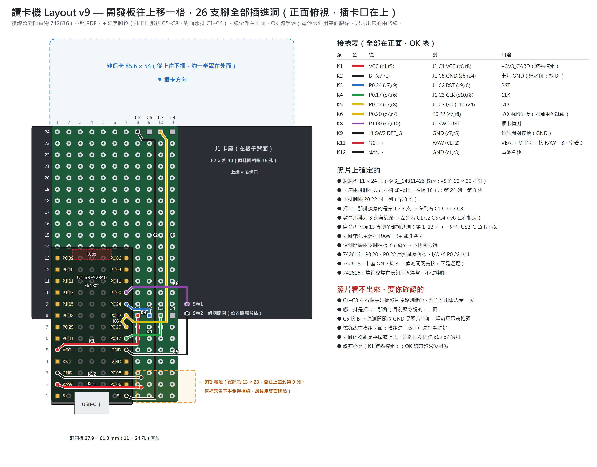
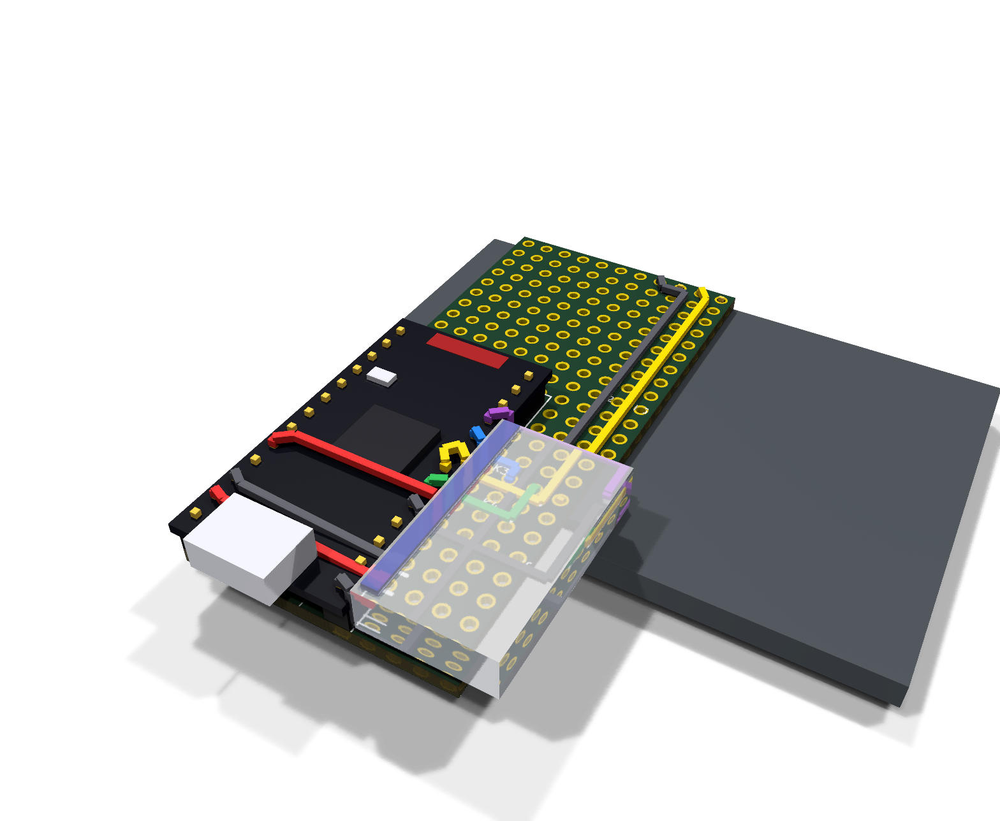

# 20261030_3D — 讀卡機（單顆 nRF52840＋健保卡卡座）

只用一顆 nRF52840 SuperMini（nice!nano 相容）接 ISO 7816 卡座，焊在一塊 11 × 24 孔的洞洞板上。
卡座在板子背面、插卡口在上，模組的 USB-C 朝下，線全部在正面用 OK 線手焊，電池最後用雙面膠黏。

接線照老師的實物照片，不照 261103_nrf_card.pdf 的線路圖。

目前版本是 v9。

## 規格

| 項目 | 內容 |
|---|---|
| 洞洞板 | 27.9 × 61 mm，11 × 24 孔，2.54 mm 間距，直放 |
| 孔位標示 | (欄 c, 列 r)：c 為 1–11（左→右），r 為 1–24（下→上），正面俯視 |
| 卡座 J1 | 在板子背面，上緣是插卡口；8 支腳焊進 c8–c11 的第 24 列和第 8 列 |
| 模組 U1 | 轉 180°、USB-C 朝下；兩排 13 支腳全部插進 c1、c7 的第 1–13 列 |
| 電池 | LiPo 約 13 × 23 mm（照片估），在模組右邊，蓋在線上面 |

## 模組腳位（轉 180° 後）

| 列 | c1 | c7 |
|---|---|---|
| 1 | B+ | B- |
| 2 | RAW | P0.06 |
| 3 | GND | P0.08 |
| 4 | RST | GND |
| 5 | VCC | GND |
| 6 | P0.31 | P0.17 |
| 7 | P0.29 | P0.20 |
| 8 | P0.02 | P0.22 |
| 9 | P1.15 | P0.24 |
| 10 | P1.13 | P1.00 |
| 11 | P1.11 | P0.11 |
| 12 | P0.10 | P1.04 |
| 13 | P0.09 | P1.06 |

## 卡座腳位

| 位置 | c8 | c9 | c10 | c11 |
|---|---|---|---|---|
| 插卡口那排（第 24 列） | C5 GND | C6 | C7 I/O | C8 |
| 對面那排（第 8 列） | C1 VCC | C2 RST | C3 CLK | C4 |

C4、C6、C8 不接線，腳還是焊進洞，用來固定卡座。

## 接線（全部走正面，用 OK 線）

| 線號 | 起點 | 終點 | 用途 |
|---|---|---|---|
| K1 | VCC (c1,r5) | J1 C1 VCC (c8,r8) | +3V3_CARD，跨過模組 |
| K2 | B- (c7,r1) | J1 C5 GND (c8,r24) | 卡片 GND（照老師：接 B-） |
| K3 | P0.24 (c7,r9) | J1 C2 RST (c9,r8) | RST |
| K4 | P0.17 (c7,r6) | J1 C3 CLK (c10,r8) | CLK |
| K5 | P0.22 (c7,r8) | J1 C7 I/O (c10,r24) | I/O |
| K6 | P0.20 (c7,r7) | P0.22 (c7,r8) | I/O 兩腳併接（老師用短跳線） |
| K8 | P1.00 (c7,r10) | J1 SW1 DET | 插卡偵測 |
| K9 | J1 SW2 DET_G | GND (c7,r5) | 偵測開關接地 |
| K11 | 電池 ＋ | RAW (c1,r2) | VBAT（照老師：接 RAW，B+ 空著） |
| K12 | 電池 － | GND (c1,r3) | 電池負極 |

## 還沒確定的

| 項目 | 目前做法 | 怎麼確認 |
|---|---|---|
| C1–C8 的左右順序 | 照實物照片的接線判斷 | 焊之前用電表量 |
| 插卡口在哪一排 | 放上面 | 實際插卡看 |
| 偵測開關 SW1 / SW2 的腳位 | 畫在板子右緣外、第 8 列旁邊 | 看卡座實物 |
| 電池大小、厚度 | 約 13 × 23 × 4.5 mm | 量電池 |

## 檔案

| 檔案 | 用途 |
|---|---|
| [`讀卡機Layout_v9.png`](card_reader_nicenano/讀卡機Layout_v9.png) / [`.svg`](card_reader_nicenano/讀卡機Layout_v9.svg) | 目前的 Layout（含接線表） |
| [`讀卡機PCB_v9.kicad_pcb`](card_reader_nicenano/讀卡機PCB_v9.kicad_pcb) / [`.png`](card_reader_nicenano/讀卡機PCB_v9.png) | KiCad 洞洞板檔，OK 線畫在絲印層 |
| `讀卡機3D_v9_正面.png`、`_背面.png`、`_斜視.png` | KiCad 3D 圖（含模組、卡座、OK 線、電池） |
| `model_*.wrl` | 3D 模型（模組、卡座、OK 線、電池），PCB 用 `${KIPRJMOD}` 找，要跟 PCB 放同一個資料夾 |
| `gen_layout_card9.py`、`gen_pcb_card9.py` | 產生 v9 Layout 和 PCB／3D 模型的程式 |
| [`讀卡機_整理.md`](card_reader_nicenano/讀卡機_整理.md) | 舊的整理筆記（內容寫到 v6，接線已過時） |
| `card_reader_nicenano/` 其他檔案 | v1–v8 的舊版，保留參考 |
