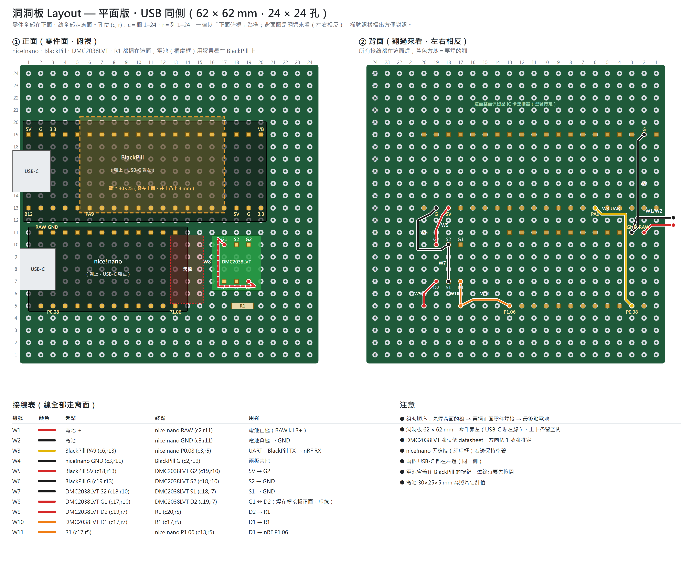

# 20261030_3D — 洞洞板版（62 × 62 mm）

nice!nano（nRF52840）＋ WeAct BlackPill（STM32F401/F411）＋ DMC2038LVT，焊在一塊 62 × 62 mm 洞洞板上。
兩塊開發板和 DMC2038LVT 都在正面，兩個 USB-C 都朝左、貼齊板邊；焊線全走背面，背面其餘空間保留給 IC 卡連接器（型號待定）。

## 規格

| 項目 | 內容 |
|---|---|
| 洞洞板 | 62 × 62 mm，24 × 24 孔，2.54 mm 間距 |
| 孔位標示 | (欄 c, 列 r)：c 為 1–24（左→右），r 為 1–24（下→上），正面俯視 |
| 正面 | BlackPill（上半）、nice!nano（下半）、DMC2038LVT（SOT-23-6 轉接板）、R1 |
| USB-C | 兩個都朝左，貼齊左板邊 |
| 背面 | 只有焊線，彼此不交叉；其餘保留給 IC 卡連接器 |
| 空孔 | 上方 4 列、下方 4 列、右側 3 欄 |

## 零件位置（全部在正面）

| 零件 | 孔位 |
|---|---|
| BlackPill | r13：B12 c1 … PA9 c6 … 5V c18、G c19、3.3 c20；r19：5V c1、G c2、3.3 c3 … VB c20 |
| nice!nano | r5：P0.06 c2、P0.08 c3、GND c4/c5 … P1.06 c13；r11：RAW c2、GND c3、RST c4、VCC c5 … P0.09 c13 |
| DMC2038LVT | r10：G1 c17、S2 c18、G2 c19；r7：D1 c17、S1 c18、D2 c19 |
| R1 | c17 r5 ↔ c20 r5 |

## 接線（全部走背面）

| 線號 | 起點 | 終點 | 用途 |
|---|---|---|---|
| W1 | 電池 ＋ | nice!nano RAW (c2,r11) | 電池正極（RAW 即 B+） |
| W2 | 電池 － | nice!nano GND (c3,r11) | 電池負極 → GND |
| W3 | BlackPill PA9 (c6,r13) | nice!nano P0.08 (c3,r5) | UART：BlackPill TX → nRF RX |
| W4 | nice!nano GND (c3,r11) | BlackPill G (c2,r19) | 兩板共地 |
| W5 | BlackPill 5V (c18,r13) | DMC2038LVT G2 (c19,r10) | 5V → G2 |
| W6 | BlackPill G (c19,r13) | DMC2038LVT S2 (c18,r10) | S2 → GND（從右側繞過） |
| W7 | DMC2038LVT S2 (c18,r10) | DMC2038LVT S1 (c18,r7) | S1 → GND |
| W8 | DMC2038LVT G1 (c17,r10) | DMC2038LVT D2 (c19,r7) | G1 ↔ D2（焊在轉接板正面） |
| W9 | DMC2038LVT D2 (c19,r7) | R1 (c20,r5) | D2 → R1 |
| W10 | DMC2038LVT D1 (c17,r7) | R1 (c17,r5) | D1 → R1 |
| W11 | R1 (c17,r5) | nice!nano P1.06 (c13,r5) | D1 → nRF P1.06 |

## 組裝注意

1. 兩塊模組貼板焊，背面針腳剪平。
2. 焊線照上表與圖上的孔位，全部走背面。
3. R1 阻值待定。

## 檔案

| 檔案 | 用途 |
|---|---|
| [`perfboard/perfboard_layout_62x62.png`](perfboard/perfboard_layout_62x62.png) / [`.svg`](perfboard/perfboard_layout_62x62.svg) | 洞洞板 layout 圖（正面、背面、接線表） |
| `scripts/gen_layout_6262.py` | 產生 layout 圖的程式 |
| [`pcb_flat/`](pcb_flat/) | 先前的 PCB 平面版（53 × 40 mm，USB-C 不同邊），保留參考 |
