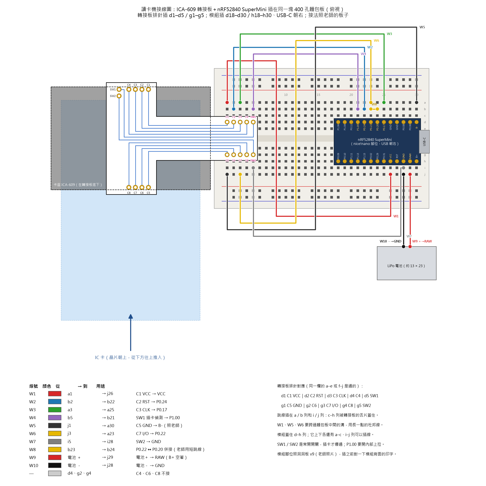
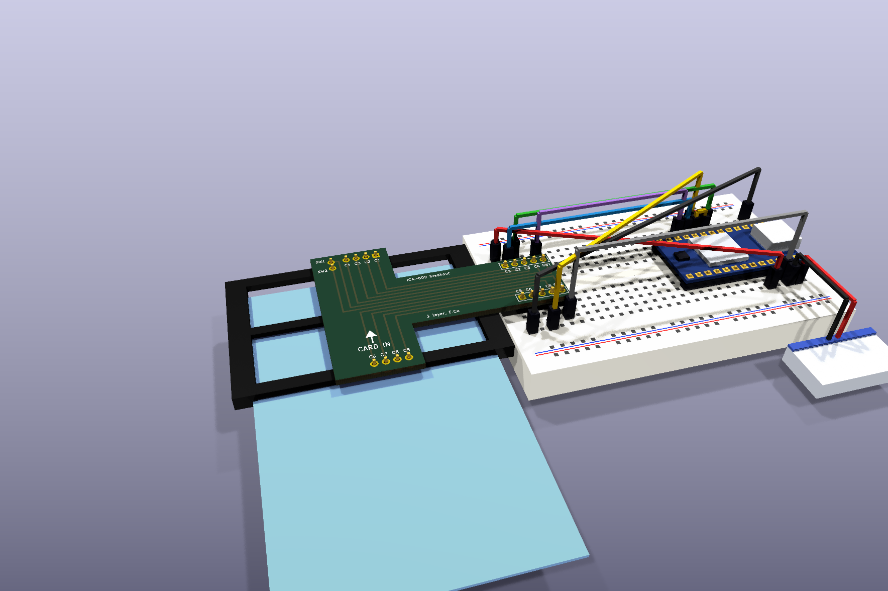

# ICA-609 卡座麵包板轉接板 ＋ nRF52840

把 Hamburg ICA-609 Type2 NO 卡座的 8 個觸點和偵測開關，轉接成兩排 1×5 排針，插在麵包板上，再用杜邦線接到 nRF52840 SuperMini（nice!nano 腳位）。接法照老師的板子。

## PCB 規格

| 項目 | 內容 |
|---|---|
| 層數 | 單面板，銅箔只在正面（F.Cu） |
| 板材／板厚 | FR-4，1.6 mm |
| 外形 | T 字形，58.76 × 43.50 mm |
| 線寬／最小間距 | 0.40 mm／0.25 mm |
| 孔 | 20 個 Ø1.00 mm（卡座 10、排針 10），沒有過孔 |
| 打樣檔 | [`gerber/ICA609_breadboard_breakout_v1_gerber.zip`](gerber/ICA609_breadboard_breakout_v1_gerber.zip)，BOM 在 [`gerber/BOM.csv`](gerber/BOM.csv) |

卡座和排針的塑膠座都裝在背面（沒有銅的那面），腳穿到正面焊。DRC、ERC 沒有錯誤。

## 接線（麵包板 400 孔）

轉接板排針插 d1–d5（C1 C2 C3 C4 SW1）和 g1–g5（C5 C6 C7 C8 SW2）。模組插 d18–d30／h18–h30，USB-C 朝右。

| 線 | 從 | 到 | 用途 |
|---|---|---|---|
| W1 紅 | a1 | j26 | C1 VCC → VCC |
| W2 藍 | b2 | b22 | C2 RST → P0.24 |
| W3 綠 | a3 | a25 | C3 CLK → P0.17 |
| W4 紫 | b5 | b21 | SW1 → P1.00（插卡偵測） |
| W5 黑 | j1 | a30 | C5 GND → B- |
| W6 黃 | j3 | a23 | C7 I/O → P0.22 |
| W7 灰 | i5 | i28 | SW2 → GND |
| W8 黃 | b23 | b24 | P0.22 和 P0.20 併接 |
| W9 紅 | 電池＋ | j29 | RAW（B+ 空著） |
| W10 黑 | 電池－ | j28 | GND |

C4、C6、C8 不接。插模組前先對一下模組背面的印字。

## 圖

| 圖 | 內容 |
|---|---|
| [`接線圖_含nRF.png`](接線圖_含nRF.png) | 整體 Layout：轉接板＋卡座＋麵包板＋nRF＋接線表 |
| [`預覽_PCB.png`](預覽_PCB.png) | PCB Layout（銅箔＋絲印） |
| [`尺寸圖.png`](尺寸圖.png)、[`配置圖_麵包板.png`](配置圖_麵包板.png) | 尺寸、在麵包板上的位置與側視 |
| `立體_整體_斜視.png`、`立體_整體_正面.png` | 3D 整體（含 nRF、杜邦線、電池） |
| `立體_PCB_斜視.png`、`_正面.png`、`_背面.png` | 3D 空板 |
| `立體_PCB單板.png`、`立體_斜視.png` 等 | 3D：裝上卡座、排針；插在麵包板上（不含 nRF） |
| [`立體檢視.html`](立體檢視.html) | 下載後用瀏覽器打開，可以用滑鼠轉（需要網路） |

## 程式

KiCad 9 以上。腳本用環境變數 `KICAD_CLI` 找 kicad-cli，沒設就用 PATH 上的 `kicad-cli`。

| 檔案 | 用途 |
|---|---|
| `gen_breakout.py` | 產生 KiCad 專案（PCB、線路圖） |
| `gen_drawings.py` | 尺寸圖、麵包板配置圖 |
| `gen_wiring_nrf.py` | 接線圖（含 nRF） |
| `gen_scene.py`、`gen_scene_nrf.py` | 3D 圖 |
| `models3d.py` | 3D 方塊模型（卡座、排針、卡片、麵包板） |
| `check_dims.py` | 對照規格書檢查尺寸 |
